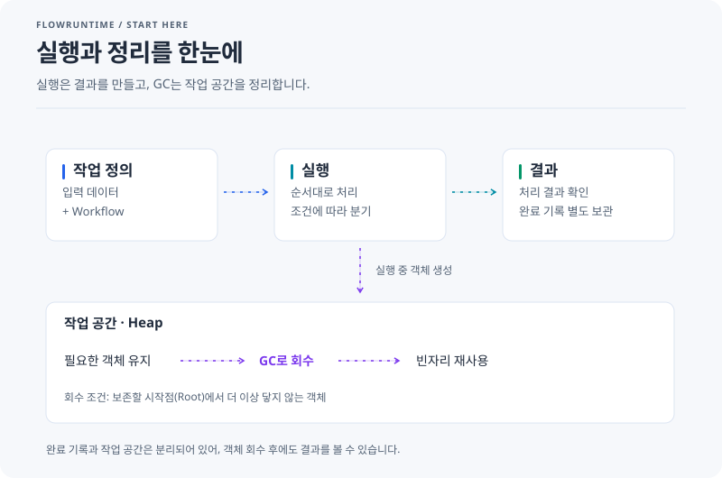
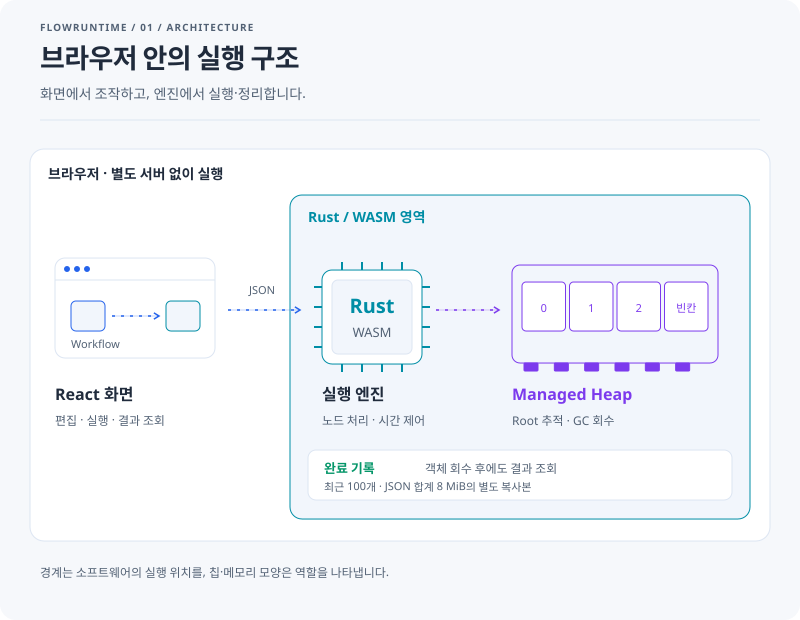
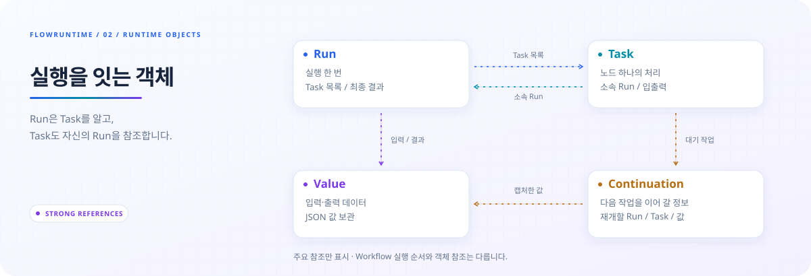
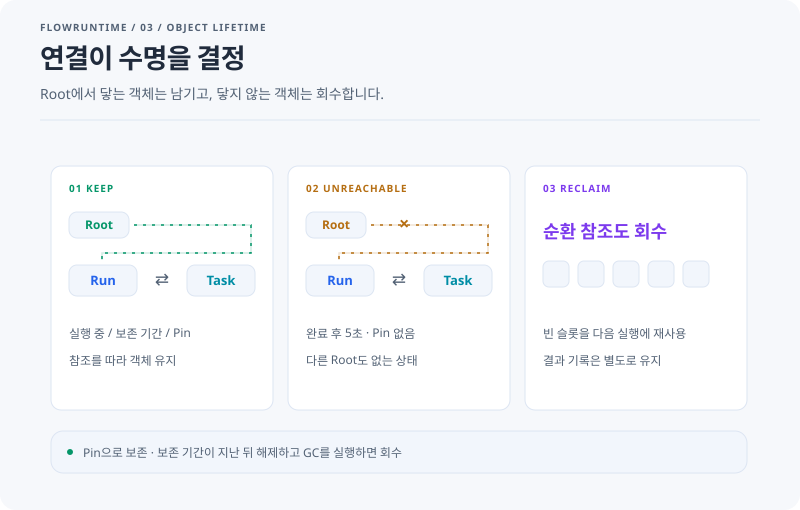
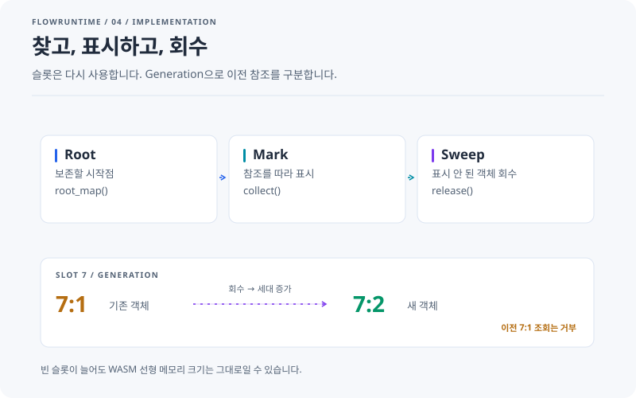
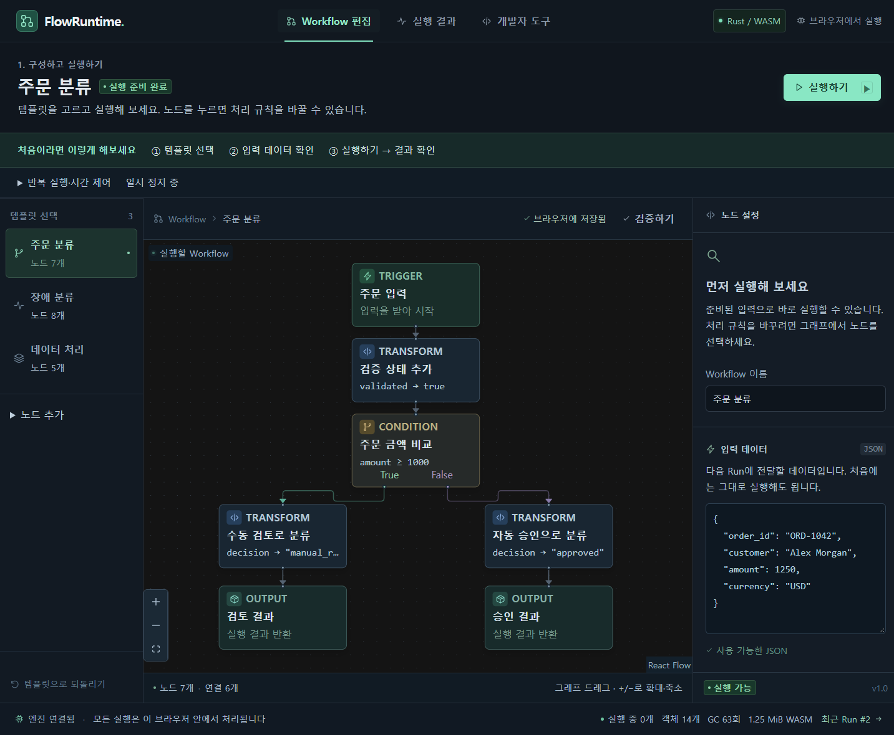

# FlowRuntime

**Workflow를 실행하고, 실행 객체가 생기고 사라지는 과정을 살펴보는 Rust/WASM 엔진입니다.**

[앱 실행하기](https://okorion.github.io/flowruntime/) · [구현 상세](docs/implementation.md) · [테스트·벤치마크](docs/validation.md) · [의존성 선택](docs/dependencies.md)

## 무엇을 볼 수 있나요?

**입력 데이터를 작업 순서에 따라 처리하고, 그 과정에서 생긴 객체를 GC가 정리하는 모습을 볼 수 있습니다.** 코드를 읽기 전에 앱에서 실행 결과와 메모리 변화를 비교해 보세요.

<picture>
  <source media="(prefers-reduced-motion: reduce) and (prefers-color-scheme: dark) and (max-width: 600px)" srcset="docs/diagrams/overview-mobile-dark-still.svg" />
  <source media="(prefers-reduced-motion: reduce) and (max-width: 600px)" srcset="docs/diagrams/overview-mobile-light-still.svg" />
  <source media="(prefers-reduced-motion: reduce) and (prefers-color-scheme: dark)" srcset="docs/diagrams/overview-dark-still.svg" />
  <source media="(prefers-reduced-motion: reduce)" srcset="docs/diagrams/overview-light-still.svg" />
  <source media="(prefers-color-scheme: dark) and (max-width: 600px)" srcset="docs/diagrams/overview-mobile-dark.svg" />
  <source media="(max-width: 600px)" srcset="docs/diagrams/overview-mobile-light.svg" />
  <source media="(prefers-color-scheme: dark)" srcset="docs/diagrams/overview-dark.svg" />
  
</picture>

그림에서 **위쪽은 결과를 만드는 과정**, **아래쪽은 실행에 쓴 작업 공간을 정리하는 과정**입니다. GC(Garbage Collection)는 보존할 시작점에서 더 이상 닿지 않는 객체를 회수합니다. 완료 기록은 별도로 보관하므로 객체를 회수한 뒤에도 결과를 확인할 수 있습니다.

> 예를 들어 주문 금액이 1,250이면 검토 대상으로, 300이면 승인 대상으로 분류합니다. 실행을 반복하면 객체가 생기고, 보존 조건이 끝난 객체는 GC가 회수하여 다음 실행에 쓸 자리를 만듭니다.

## 두 가지를 비교해 보세요

| 확인할 것 | 앱에서 해볼 일 | 관찰할 변화 |
| --- | --- | --- |
| 입력에 따라 결과가 달라지는가 | **주문 분류 → 실행하기 → 실행 결과**. 입력의 `amount`를 1,250과 300으로 바꿔 실행 | `manual_review`와 `approved`로 결과가 달라집니다. |
| 완료된 실행의 객체는 언제 없어지는가 | **개발자 도구**에서 자동 GC를 끄고 실행한 뒤, 가상 시간 **+5초를 두 번 → GC 실행** | 다른 실행이나 Pin이 없으면 Heap 점유 객체가 0개로 줄어듭니다. 완료 기록은 남습니다. |

**Pin은 객체를 계속 보존하는 표시입니다.** Pin을 켜고 같은 실험을 하면 객체가 남고, 보존 기간이 지난 뒤 Pin을 해제하고 GC를 실행하면 회수됩니다.

아래 그림은 실제 코드의 역할과 흐름을 단순화한 **개념도**입니다. 움직이는 선은 명령과 참조의 방향이며, 실시간 실행 상태를 나타내지는 않습니다. 슬롯 번호는 설명용 예시입니다.

## 화면·실행 엔진·작업 공간의 역할

<picture>
  <source media="(prefers-reduced-motion: reduce) and (prefers-color-scheme: dark) and (max-width: 600px)" srcset="docs/diagrams/architecture-mobile-dark-still.svg" />
  <source media="(prefers-reduced-motion: reduce) and (max-width: 600px)" srcset="docs/diagrams/architecture-mobile-light-still.svg" />
  <source media="(prefers-reduced-motion: reduce) and (prefers-color-scheme: dark)" srcset="docs/diagrams/architecture-dark-still.svg" />
  <source media="(prefers-reduced-motion: reduce)" srcset="docs/diagrams/architecture-light-still.svg" />
  <source media="(prefers-color-scheme: dark) and (max-width: 600px)" srcset="docs/diagrams/architecture-mobile-dark.svg" />
  <source media="(max-width: 600px)" srcset="docs/diagrams/architecture-mobile-light.svg" />
  <source media="(prefers-color-scheme: dark)" srcset="docs/diagrams/architecture-dark.svg" />
  
</picture>

React는 편집·조작·표시를 맡고, Rust/WASM은 노드 실행과 객체 수명을 관리합니다. 실행에는 백엔드가 필요하지 않습니다. 편집한 Workflow 정의는 브라우저에 저장됩니다.

<details>
<summary>한 단계 더 보기 · 실행 중에는 어떤 객체가 생길까요?</summary>


<picture>
  <source media="(prefers-reduced-motion: reduce) and (prefers-color-scheme: dark) and (max-width: 600px)" srcset="docs/diagrams/objects-mobile-dark-still.svg" />
  <source media="(prefers-reduced-motion: reduce) and (max-width: 600px)" srcset="docs/diagrams/objects-mobile-light-still.svg" />
  <source media="(prefers-reduced-motion: reduce) and (prefers-color-scheme: dark)" srcset="docs/diagrams/objects-dark-still.svg" />
  <source media="(prefers-reduced-motion: reduce)" srcset="docs/diagrams/objects-light-still.svg" />
  <source media="(prefers-color-scheme: dark) and (max-width: 600px)" srcset="docs/diagrams/objects-mobile-dark.svg" />
  <source media="(max-width: 600px)" srcset="docs/diagrams/objects-mobile-light.svg" />
  <source media="(prefers-color-scheme: dark)" srcset="docs/diagrams/objects-dark.svg" />
  
</picture>

Workflow의 화살표는 **노드 실행 순서**, Heap의 화살표는 **객체 사이의 참조**입니다. Workflow는 순환 없는 DAG지만, 실행 객체는 Run ⇄ Task처럼 서로 참조할 수 있습니다.

</details>

## GC는 무엇을 남기고 지울까요?

<picture>
  <source media="(prefers-reduced-motion: reduce) and (prefers-color-scheme: dark) and (max-width: 600px)" srcset="docs/diagrams/gc-cycle-mobile-dark-still.svg" />
  <source media="(prefers-reduced-motion: reduce) and (max-width: 600px)" srcset="docs/diagrams/gc-cycle-mobile-light-still.svg" />
  <source media="(prefers-reduced-motion: reduce) and (prefers-color-scheme: dark)" srcset="docs/diagrams/gc-cycle-dark-still.svg" />
  <source media="(prefers-reduced-motion: reduce)" srcset="docs/diagrams/gc-cycle-light-still.svg" />
  <source media="(prefers-color-scheme: dark) and (max-width: 600px)" srcset="docs/diagrams/gc-cycle-mobile-dark.svg" />
  <source media="(max-width: 600px)" srcset="docs/diagrams/gc-cycle-mobile-light.svg" />
  <source media="(prefers-color-scheme: dark)" srcset="docs/diagrams/gc-cycle-dark.svg" />
  
</picture>

보존할 시작점(Root)은 **진행 중인 실행, 완료 후 5초 이내의 실행, Pin한 실행, 다음 작업을 기다리는 정보**입니다. 코드에서는 실행 한 번을 `Run`, 다음 작업을 이어 갈 정보를 `Continuation`이라고 부릅니다. 5초는 엔진의 가상 시간 기준이며, GC는 이 시작점에서 참조를 따라 닿는 객체를 남깁니다.

서로 참조하는 객체라도 Root와 연결이 끊기면 함께 회수됩니다. **객체끼리 연결되어 있는지보다, 보존할 시작점에서 닿을 수 있는지가 기준입니다.**

<details>
<summary>코드로 더 보기 · Root → Mark → Sweep과 슬롯 재사용</summary>


<picture>
  <source media="(prefers-reduced-motion: reduce) and (prefers-color-scheme: dark) and (max-width: 600px)" srcset="docs/diagrams/gc-implementation-mobile-dark-still.svg" />
  <source media="(prefers-reduced-motion: reduce) and (max-width: 600px)" srcset="docs/diagrams/gc-implementation-mobile-light-still.svg" />
  <source media="(prefers-reduced-motion: reduce) and (prefers-color-scheme: dark)" srcset="docs/diagrams/gc-implementation-dark-still.svg" />
  <source media="(prefers-reduced-motion: reduce)" srcset="docs/diagrams/gc-implementation-light-still.svg" />
  <source media="(prefers-color-scheme: dark) and (max-width: 600px)" srcset="docs/diagrams/gc-implementation-mobile-dark.svg" />
  <source media="(max-width: 600px)" srcset="docs/diagrams/gc-implementation-mobile-light.svg" />
  <source media="(prefers-color-scheme: dark)" srcset="docs/diagrams/gc-implementation-dark.svg" />
  
</picture>

| 읽는 순서 | 코드 | 하는 일 |
| --- | --- | --- |
| 1 | [root_map()](engine/src/diagnostics.rs) | 보존할 객체의 시작점 수집 |
| 2 | [collect()](engine/src/gc.rs) | 참조를 따라 Mark, 표시되지 않은 객체 Sweep |
| 3 | [references() / release()](engine/src/heap.rs) | 참조 목록 제공, 객체 제거, Generation 증가, 슬롯 재사용 |
| 4 | [finish() / run_detail()](engine/src/runtime.rs) · [기록 조회](engine/src/diagnostics.rs) | 완료 기록 복사, GC 이후에도 결과 조회 |

GC는 앱이 만든 Run·Task·Value·Continuation을 관리합니다. Rust의 모든 할당이나 JS 객체·DOM을 추적하지 않습니다. 빈 슬롯은 다음 실행에서 재사용하며, 객체가 줄어도 WASM 선형 메모리 크기는 그대로일 수 있습니다.

완료 결과·Task·실행 정의는 **최근 100개·JSON 합계 8 MiB** 한도 안에서 별도로 보관합니다. 이 기록은 Root가 아니며, 새로고침·초기화·진단 기록 지우기로 삭제됩니다.

</details>

<details>
<summary>실제 앱 화면 보기</summary>



</details>

## 로컬 실행

Node.js 22.12 이상, Rust 1.99.0, wasm-bindgen CLI 0.2.129를 사용합니다.

```bash
git clone https://github.com/okorion/flowruntime.git
cd flowruntime
rustup target add wasm32-unknown-unknown
cargo install wasm-bindgen-cli --version 0.2.129 --locked
npm ci
npm run build:wasm
npm run dev
```

`http://127.0.0.1:5174`에서 엽니다. Rust를 변경하면 `npm run build:wasm`을 다시 실행합니다.

## 더 살펴보기

- [구현 상세](docs/implementation.md): 실행 순서, 객체 참조, Root 정책, 안전 제한
- [검증과 벤치마크](docs/validation.md): Rust·WASM·브라우저 검사, 측정 조건과 결과
- [의존성 선택](docs/dependencies.md): 직접 구현과 라이브러리의 역할
- [그림 원본](docs/diagrams/): 밝은/어두운 테마와 모바일 SVG · [재생성 스크립트](scripts/render-doc-diagrams.mjs)

현재는 단일 스레드, 단일 입력 DAG, 최상위 JSON 필드의 변환·비교와 가상 시간 Delay를 지원합니다. Join·반복 Edge·외부 API·사용자 코드 실행은 지원하지 않습니다.

[MIT License](LICENSE)
