# FlowRuntime

**Local-First Visual Workflow Engine with a Custom Rust/WASM Garbage Collector**

FlowRuntime은 브라우저에서 워크플로우를 편집하고 입력 JSON을 실행하는 도구입니다. Rust 엔진이 변환·분기·지연·출력을 처리하며, Developer Tools에서 같은 실행의 객체와 참조 관계, GC 회수 결과를 확인할 수 있습니다. 워크플로우 정의는 브라우저에 저장됩니다.

[라이브 데모](https://okorion.github.io/flowruntime/) · [소스](https://github.com/okorion/flowruntime) · [검증과 벤치마크](docs/validation.md) · [의존성 선택](docs/dependencies.md)


## 사용하기

1. **Workflow 편집**에서 **주문 분류** 템플릿을 선택합니다.
2. 오른쪽 입력 JSON을 확인하고 **실행하기**를 누릅니다.
3. **실행 결과**에서 결과 JSON과 처리한 노드 순서를 확인합니다. 기본 입력의 `amount: 1250`은 `decision: "manual_review"`로 분류됩니다. `amount`를 `300`으로 바꾸면 `"approved"`가 됩니다.

노드를 선택하면 설정 JSON이 나타납니다. **노드 추가**를 펼치면 새 노드를 추가할 수 있습니다. 실행은 현재 정의의 독립적인 스냅샷을 사용합니다.

**반복 실행·시간 제어**를 펼치면 Burst·반복 실행·일시 정지·Step을 사용할 수 있습니다. Burst는 한 번에 여러 입력을 실행하고, 반복 실행은 이 정적 앱 안에서 합성 입력을 생성합니다. 외부 이벤트·결제·메일·Webhook·사용자 코드는 실행하지 않습니다.

객체의 수명을 살펴보려면 **개발자 도구**로 이동합니다. Heap은 남아 있는 객체, GC는 회수 전후, References는 참조 관계를 보여 줍니다. GC 화면의 **객체 회수를 직접 확인하는 방법**을 펼치면 재현 순서가 나옵니다. Run을 Pin하면 보존 기간이 지나도 객체를 유지합니다.

## 화면

| 화면 | 확인할 내용 |
| --- | --- |
| Workflow Studio | 템플릿, 노드 추가·삭제·연결, JSON 설정, 입력 편집, 검증, 팬·줌 |
| Execution Monitor | 완료·실패·대기 실행, 노드 Timeline, 결과 JSON, 정의 스냅샷, Pin·취소·객체 추적 |
| Heap | 실제 슬롯 상태, 객체 유형, 할당·재사용 횟수, 제한된 시계열, WASM 메모리 |
| GC | Root·Mark·Sweep 결과, 실제 수집 시간, 자동 수집 설정, 직전·직후 스냅샷 |
| References | Run·Task·Value·Continuation의 강한 참조, Root와 도달 가능성, 세대가 포함된 Handle |

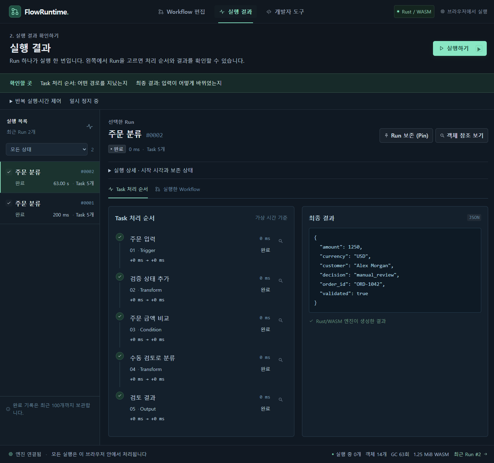
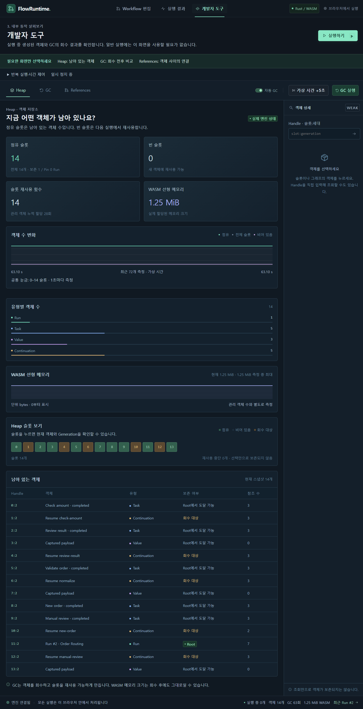
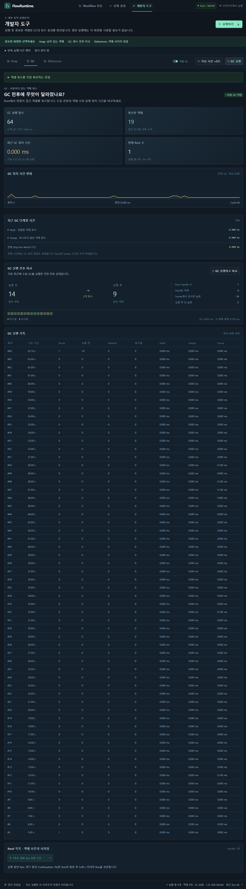
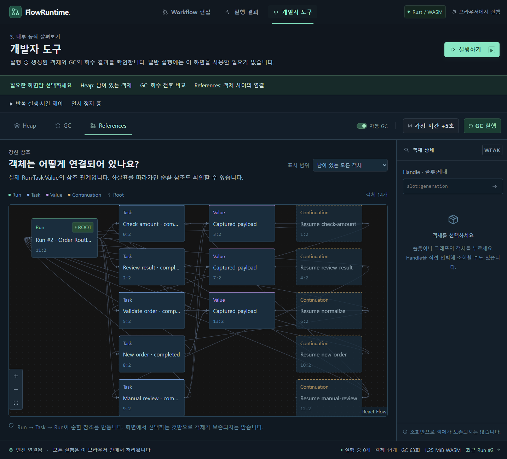

## 실행 모델과 아키텍처

React Flow가 그래프 편집과 렌더링을 맡습니다. React는 실행을 지시하고 조회 스냅샷을 표시합니다. 노드 실행, 가상 시간 스케줄링, Root 관리와 GC는 Rust에 있습니다.

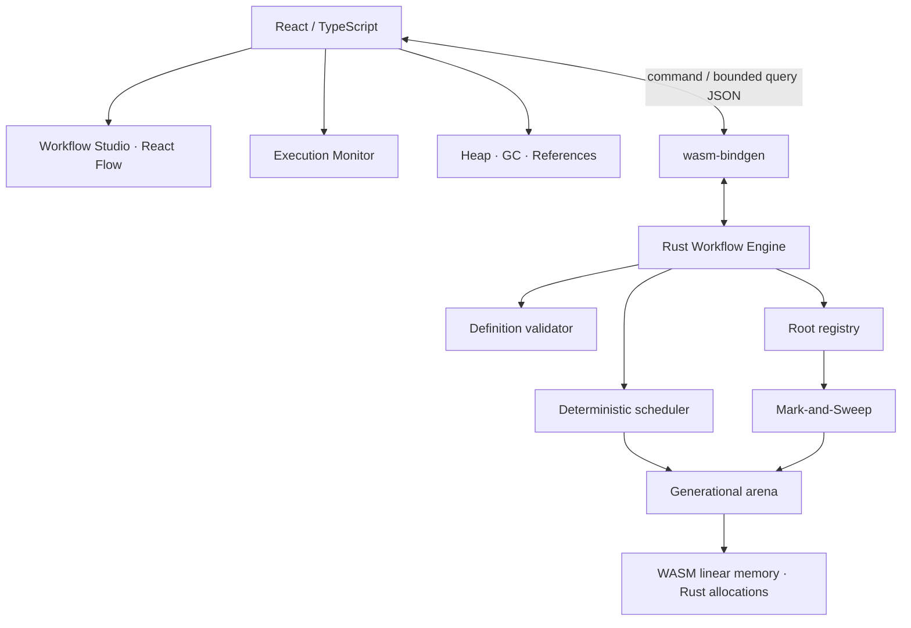

기술 스택은 Rust, wasm-bindgen, Serde, React 19, TypeScript, Vite, React Flow, Vitest, Playwright, GitHub Actions와 GitHub Pages입니다. 실행에 백엔드가 필요하지 않습니다. [package-lock.json](package-lock.json)과 [Cargo.lock](engine/Cargo.lock)이 설치 버전을 고정합니다.

### Workflow Definition과 Runtime Object

정의는 노드·Edge·설정을 가진 DAG입니다. 현재는 Trigger 하나, Trigger 외 노드마다 입력 Edge 하나, Condition의 true/false 분기, Output까지의 완전한 경로를 요구합니다. Trigger에는 입력 Edge가 없습니다. Join과 정의의 순환 Edge는 검증 단계에서 거부합니다.

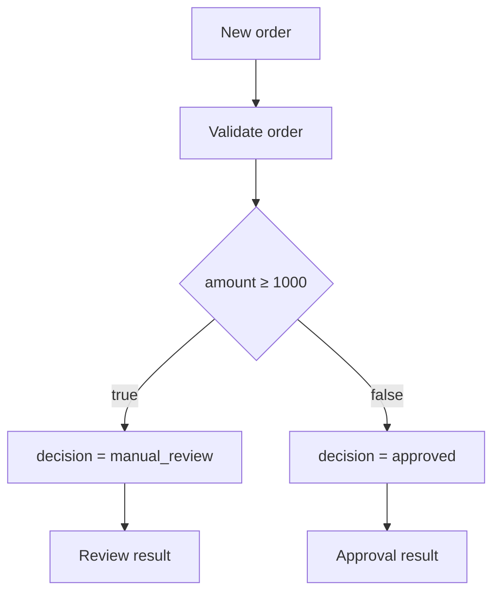

이 정의에서 Run을 시작할 때 런타임 객체를 할당합니다. **정의의 연결은 실행 순서**, **객체의 참조는 살아 있어야 할 데이터의 연결**입니다. 따라서 정의가 DAG여도 객체 참조에는 순환이 생깁니다.

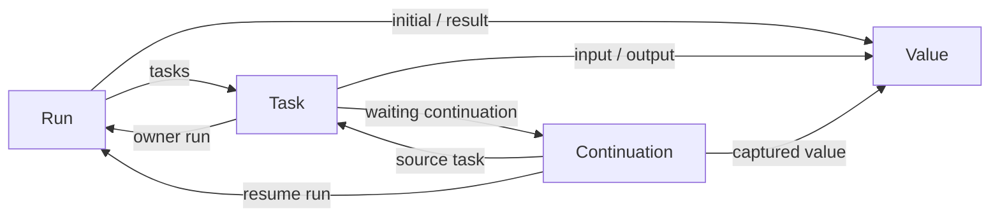

### 결정론적인 실행

스케줄러는 `(due time, sequence)` 순서로 이벤트를 꺼냅니다. 노드는 상수 할당, 최상위 JSON 필드 비교, 가상 지연만 수행합니다. 난수와 외부 입출력이 없으므로 동일한 입력·정의·가상 시간 진행에서 논리적 결과가 같습니다. GC 정책은 슬롯 배치와 수집 시점을 바꿀 수 있습니다.

```mermaid
flowchart LR
  Input[Input JSON] --> Validate[Validate definition]
  Validate --> Snapshot[Snapshot definition]
  Snapshot --> Allocate[Allocate Run / Value]
  Allocate --> Queue[Queue continuation]
  Queue --> Execute[Execute due task]
  Execute -->|next / delay| Queue
  Execute -->|output / error / cancel| Finish[Finish run]
  Finish --> Retain[Retain / pin roots]
```

Trigger는 입력을 전달하고, Transform은 필드 하나를 할당합니다. Condition은 `eq`, `ne`, `gt`, `gte`, `lt`, `lte`, `exists`를 지원합니다. 숫자 비교에서 입력 필드가 없거나 숫자가 아니면 false입니다. Delay는 값을 캡처한 Continuation을 스케줄러에 등록합니다. Output은 Heap의 결과 Value를 Run에 연결합니다. `Transform.config.fail: true`로 명시적인 오류 경로를 재현할 수 있습니다.

브라우저의 타이머는 고정된 가상 시간 조각을 Rust에 전달합니다. 화면 조회는 별도 주기로 수행합니다. Pause는 가상 시간 진행을 멈추고, Step은 일시 정지 상태에서 정해진 시간만 진행합니다. 같은 시각에 예정된 여러 노드는 한 Step에서 함께 실행될 수 있습니다.

## Managed Heap과 GC

### 어떤 객체를 관리하는가

관리 대상은 **Run, Task, Value, Continuation** 네 종류입니다. Run은 정의 스냅샷·Task·결과를, Task는 owner Run·입력·출력·대기 Continuation을, Continuation은 재개할 Run·Task·캡처 값을 참조합니다. Value에는 JSON payload가 있습니다. 실행은 이 Handle을 조회해 입력을 읽고 다음 작업을 이어 갑니다.

각 `Handle`은 `index: u32`와 `generation: u32`입니다. 조회 시 슬롯 범위, 점유 상태와 세대를 확인합니다. 슬롯을 해제하면 세대가 증가하고 free list에 들어갑니다. 해제 시 세대를 더 증가시킬 수 없는 슬롯은 retired로 남겨 재사용을 중단합니다.

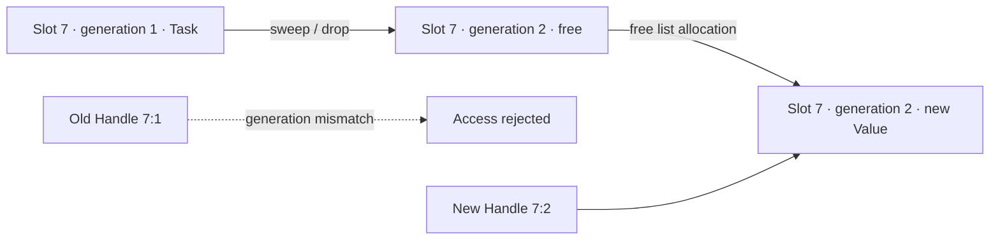

여기의 generation은 **오래된 Handle 판별용 세대**입니다. 수집 알고리즘은 세대별 GC가 아닌 단일 Mark-and-Sweep입니다.

### Root와 보존 정책

Root는 활성 Run, 완료 후 5,000 가상 ms 이내의 Run, 사용자가 Pin한 Run, 스케줄러의 대기 Continuation입니다. 객체 선택·Handle 복사는 조회용이며 Root를 추가하지 않습니다. Pin이 해제되어도 보존 기간이 남았다면 그 기간까지 유지합니다.

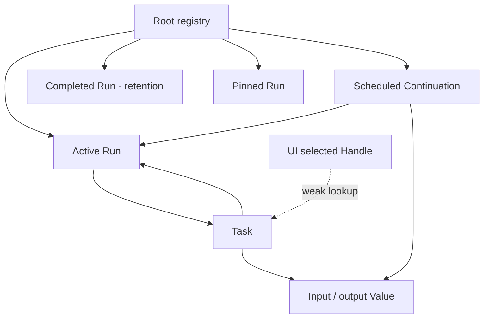

### Mark-and-Sweep

단일 스레드의 안전한 이벤트 경계에서 Stop-the-World 수집을 수행합니다. 작업 실행 중 임시 객체를 할당하고 연결하는 동안은 수집하지 않습니다.

1. 유효 Root를 모으고 이전 Mark를 지웁니다.
2. 명시적인 스택으로 Root에서 강한 참조를 따라갑니다. 같은 객체는 한 번만 방문합니다.
3. 슬롯을 순회하며 Mark되지 않은 점유 객체를 `take()`하여 Drop합니다.
4. 세대를 올리고 슬롯을 free list에 돌려줍니다.
5. 방문·검사·회수 개수와 실제 경과 시간을 기록합니다.

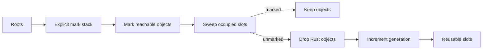

Run→Task→Run의 순환도 Root에서 끊기면 둘 다 Mark되지 않아 회수됩니다. 순환의 참조 개수를 세지 않으므로 서로를 참조한다는 이유로 남지 않습니다.

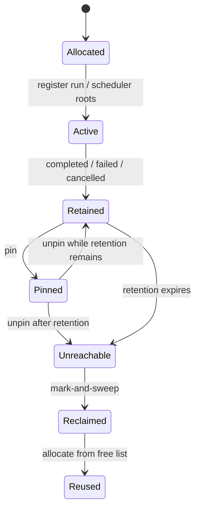

자동 GC는 할당 512회 증가, 가상 시간 1,000 ms 경과, 보수적인 Heap 예산의 75% 초과 중 하나가 성립하는 안전 경계에서 수집합니다. 수동 Collect는 자동 설정과 별도로 실행됩니다. GC Off 상태에도 슬롯·payload·작업량 제한이 적용됩니다.

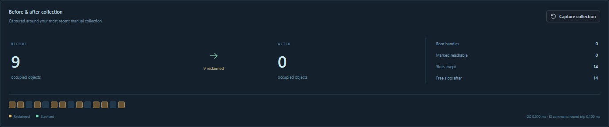

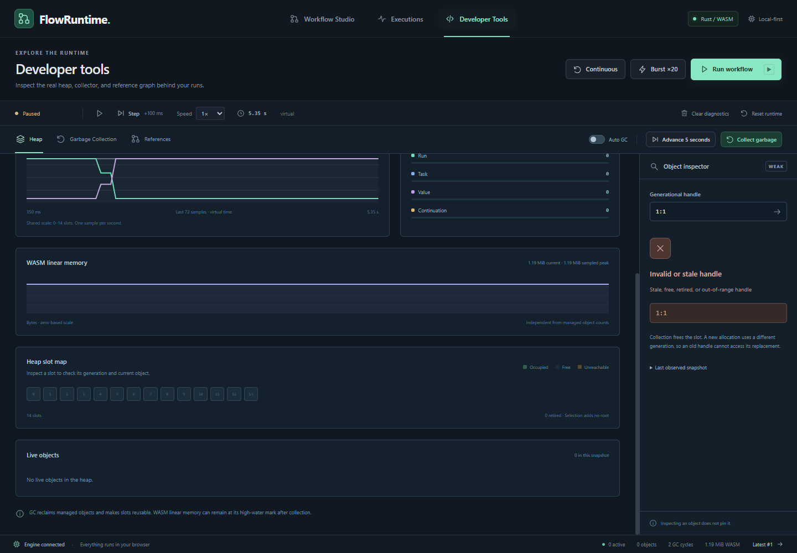

### 메모리와 시간 읽기

| 값 | 의미 |
| --- | --- |
| Live objects | arena에서 현재 점유된 객체 수. Root에서 끊겼지만 아직 수집되지 않은 객체도 포함 |
| Reachable | 현재 Root에서 강한 참조로 도달 가능한 객체 |
| Capacity / free slots | 만들어진 슬롯 수 / 재사용 가능한 빈 슬롯 수 |
| Allocations / reused slots | Heap 객체 할당 / 기존 슬롯 재사용 횟수 |
| Marked / swept / reclaimed | Mark된 객체 / Sweep에서 검사한 슬롯 / 실제 Drop된 객체 |
| WASM linear memory | `WebAssembly.Memory.buffer.byteLength`로 읽은 메모리 크기 |

내부 `Vec`, `String`, JSON 데이터는 관리 객체가 Drop될 때 Rust 할당기가 처리합니다. GC는 이 arena의 도달 가능성을 관리합니다. Rust의 모든 할당이나 JS 객체·DOM을 추적하지 않습니다. Rust 할당 총량은 별도로 계측하지 않았습니다. Heap의 보수적인 예산은 안전 제한에 쓰는 계산값입니다.

슬롯과 Rust 할당 영역은 다음 실행에서 재사용됩니다. WASM 메모리는 커진 페이지를 브라우저에 즉시 반환하는 구조가 아니므로 객체를 회수한 후에도 linear memory 크기가 그대로일 수 있습니다.

GC의 Mark·Sweep·총 Pause는 Rust 코드 안에서 측정합니다. 네이티브는 `Instant`, 브라우저 WASM은 `Performance.now()`를 사용합니다. 총 Pause는 Root 구성부터 Sweep 완료까지이며, 조회 JSON 직렬화와 React 렌더링은 포함하지 않습니다. 브라우저의 시간 해상도 때문에 짧은 구간은 0으로 관찰될 수 있습니다. [실측 결과와 타이머 지연](docs/validation.md)을 함께 확인하세요.

## 안전 제한과 초기화

노드 64개, Edge 128개, 활성 Run 256개, 대기 이벤트 4,096개, 입력·변환 payload 16 KiB, 정의 128 KiB, tick당 이벤트 100,000개, Delay 60,000 ms, Run timeout 120,000 가상 ms를 제한합니다. tick/step 한 번의 증가량은 0–60,000 ms, 절대 가상 시간은 10¹² ms까지입니다. 슬롯은 100,000개, 보수적인 Heap 예산은 64 MiB, Pin은 64개까지입니다. 오류는 UI에 반환하고 실행 실패 위치에 기록합니다.

완료 기록은 최근 100개·직렬화한 JSON 합계 8 MiB 한도 내에서 보관하며, 한도를 넘으면 오래된 기록부터 지웁니다. 결과·Task 입출력·처리 순서·실행 정의를 복사해 두므로 GC가 실행 객체를 회수한 뒤에도 실행 결과 화면을 읽을 수 있습니다. 이 기록의 Handle은 조회 당시 식별자이며 객체를 보존하는 Root가 아닙니다. 회수된 객체의 Pin·참조 보기 버튼은 비활성화됩니다. 기록은 새로고침·실행 초기화·진단 기록 지우기로 삭제됩니다.

GC 기록은 60개, Heap 조회는 256슬롯, 참조 조회는 120객체까지 반환합니다. 활성·Pin 실행은 완료 기록 한도와 별도로 유지됩니다. JSON 용량 제한은 직렬화 크기 기준이며 Rust allocator의 실제 메모리 사용량과 다릅니다.

**Reset runtime**은 실행과 Root를 초기화합니다. 슬롯 세대는 보존하여 이전 Handle을 다시 유효하게 만들지 않습니다. **Clear diagnostics**는 진단 기록을 지우고 활성·보존·Pin Root를 유지합니다. **Reset workflow definition**은 편집 정의와 입력 JSON을 선택한 템플릿 값으로 되돌립니다. 실행 상태를 초기화해도 편집한 정의는 유지됩니다.

## 로컬 실행

준비물: Node.js 22.12 이상, Rust 1.99.0, `wasm32-unknown-unknown` target, wasm-bindgen CLI 0.2.129. Rust와 CLI 버전은 빌드 바인딩 버전과 맞춥니다.

```bash
git clone https://github.com/okorion/flowruntime.git
cd flowruntime
rustup target add wasm32-unknown-unknown
cargo install wasm-bindgen-cli --version 0.2.129 --locked
npm ci
npm run build:wasm
npm run dev
```

`http://127.0.0.1:5174`에서 엽니다. Rust 변경 후 `npm run build:wasm`을 다시 실행합니다. 프론트엔드는 Vite HMR을 사용합니다.

```bash
npm run test:rust
npm test
npm run typecheck
npx playwright install chromium
npm run test:e2e
npm run build
npm run preview
```

Rust 핵심은 WASM 없이 네이티브 테스트할 수 있습니다. Vitest는 생성된 실제 WASM API를 호출하고, Playwright는 편집부터 GC까지 UI를 조작합니다. 프로덕션 미리보기 주소는 `http://127.0.0.1:4174`입니다.

```bash
npm run benchmark:native
# 별도 터미널에서 npm run dev 실행 후:
npm run benchmark:browser
```

## 검증과 한계

테스트·벤치마크의 실제 환경, 명령, 결과와 GC 시간은 [검증 문서](docs/validation.md)에 있습니다. 100·1,000·10,000 Run을 배치로 반복하고 수집 후 슬롯과 Root 상태, 진단 기록 한도를 확인합니다. GC Off 측정도 안전 상한 안에서 배치 경계에 명시적으로 수집합니다.

2026-10-12, Windows 10·i7-9700·Chromium 156에서 실제 release WASM을 측정했습니다. 아래는 완료 상세 기록 보관을 추가하기 전 버전에서 100 Run 배치로 총 10,000 Run을 실행한 결과입니다. 각 조건은 20 Run warm-up 후 1회 측정했습니다. 현재 버전의 상세 기록 복사 비용을 포함한 성능은 재측정하지 않았습니다.

| 자동 GC | 실행 dispatch 합계 | 단일 GC 최대 | 최종 슬롯 수 | 재사용 횟수 | 최종 점유 객체 |
| :---: | ---: | ---: | ---: | ---: | ---: |
| On | 622.3 ms | 1.6 ms | 1,228 | 159,092 | 0 |
| Off + 배치별 수동 수집 | 484.5 ms | 1.9 ms | 1,600 | 158,720 | 0 |

두 조건 모두 관리 객체 160,000개를 할당·회수했습니다. WASM 메모리 최고 크기는 3,932,160 bytes였습니다. 전체 동기 배치의 브라우저 timer 지연 p95는 각각 29.4/26.7 ms였으며 실행·진단 조회·수집이 포함됩니다. dispatch 합계에는 자동 GC가 포함되고, 별도 수동 GC 시간은 제외됩니다. 전체 측정 구간과 100·1,000 Run 결과, 원시 데이터는 검증 문서에서 확인할 수 있습니다.

현재는 단일 스레드·단일 입력 DAG, 최상위 JSON 필드, 상수 할당과 단순 비교를 지원합니다. Join, 반복 Edge, 외부 API, 사용자 코드, 백엔드 동기화는 지원하지 않습니다. 많은 live 객체를 Pin하면 수집 비용과 메모리가 늘어납니다. 큰 수집은 메인 스레드를 정지시키므로 장기 확장에서는 Worker 격리·증분 수집·진단 전송량을 검토할 수 있습니다.

명시적 수명 관리는 회수 시점을 더 직접적으로 제어하고 tracing 비용을 줄일 수 있습니다. 이 구현의 GC는 Run·Task·Continuation의 공유·순환 관계를 Root 정책 하나로 관리하는 대신, 전체 참조 추적·안전 경계·추가 Heap 메타데이터를 유지해야 합니다. 동일 기능의 명시적 수명 관리 구현과 비교한 벤치마크는 없습니다.

## 소스 둘러보기

- [Rust 엔진](engine/src/): 정의 검증, 스케줄러, Heap·Root·GC, native tests
- [WASM adapter](web/src/engine.ts): command/query 경계와 linear memory 조회
- [제품 UI](web/src/App.tsx): 실행 제어·가상 시간·화면 상태
- [템플릿](web/src/templates.ts): 세 가지 실제 실행 정의
- [Developer Tools](web/src/components/DeveloperTools.tsx): Heap·GC·참조 시각화
- [CI/CD](.github/workflows/ci.yml): Rust 검사, WASM·웹 빌드, Vitest·Playwright, Pages 배포

[MIT License](LICENSE)
